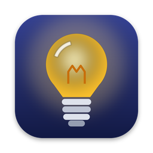

# Brightness+

**Use your Mac's brightness keys on every screen, not just the built-in one.**

Brightness+ lets the brightness keys and a simple slider control external monitors and TVs the same way they control a MacBook's own display. Point at a screen, press brighter or dimmer, and that screen changes, with a large, easy-to-read indicator in the middle of it.

It was made with low-vision users in mind: big controls, a high-contrast on-screen indicator, and no keyboard shortcuts to memorize.

## How it works

| Screen | What Brightness+ does |
| --- | --- |
| **Built-in display** | Nothing new. macOS handles it as usual. |
| **Monitors that support DDC/CI** (most desktop monitors over USB-C, DisplayPort or Thunderbolt) | Changes the monitor's real backlight, just like its own buttons would. |
| **TVs, AirPlay displays, virtual displays and monitors without DDC/CI** | Adds a dimming layer over the picture. It looks and feels the same, but it can only go down from the screen's own brightness setting. Set the TV to full brightness once with its remote for the widest range. |

- The brightness keys act on **whichever screen the pointer is on**.
- Hold **Option + Shift** while pressing them for smaller steps.
- Click the lightbulb in the Dock to open a small window with one slider per screen.
- Levels are remembered between launches.

## Requirements

- A Mac with Apple silicon (M1 or later)
- macOS 13 Ventura or later
- Apple's free command-line developer tools. If you don't have them, open Terminal and run `xcode-select --install`.

## Install

1. Download **Brightness+.zip** from the [latest release](../../releases/latest) and unzip it.
2. Move **Brightness+.app** into your **Applications** folder.
3. Open it. The first time, it builds itself on your Mac, which takes a few seconds. Because it isn't from the App Store, macOS may ask you to confirm: right-click the app, choose **Open**, then **Open** again.
4. When asked, turn on Brightness+ in **System Settings › Privacy & Security › Accessibility**. The brightness keys need this permission.
5. To keep it handy, right-click the lightbulb in the Dock and choose **Options › Keep in Dock**.

Brightness+ **keeps working after you close or quit it**: it slips into the background (no Dock dot) and the keys and dimming carry on. It also starts quietly at login and restarts itself if it ever stops. Click the lightbulb in the Dock to bring the window back. To turn it off completely, switch off **Keep working when closed** in its window, then quit.

## Notes

- Some HDMI ports and most DisplayLink docks block DDC/CI. On those connections a monitor gets the dimming layer instead of backlight control.
- Some monitors ship with DDC/CI switched off in their own on-screen menu. Turn it on there.
- Screens whose name contains "Sony" or "Bravia" are grouped into one "Sony TV" control, so a TV that shows up as more than one display moves together.

## Building

There's no Xcode project. The app's launcher (`Contents/MacOS/launch`) compiles `Contents/Resources/main.swift` with `swiftc` whenever the source changes, then runs it. Edit the Swift file and reopen the app to rebuild.

The icon is drawn by `tools/make_icons.py`. Each push to `main` redraws it and publishes `Brightness+.zip` to the release automatically.

## License

MIT. See [LICENSE](LICENSE).
